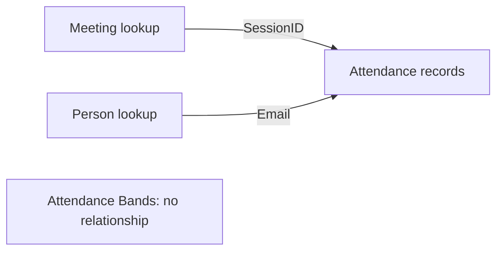

# Attendance relationships

[Build the model](../guide/attendance_rebuild.md) · [Data flow](../guide/attendance_data_flow.md)

A relationship connects a meeting or person to the matching attendance rows. It controls which records a selection includes.

Create these two active relationships in Model view:

| One side | Many side | Cross filter direction |
| --- | --- | --- |
| dimSession[SessionID] | factAttendance[SessionID] | Single, from dimSession |
| dimPerson[Email] | factAttendance[Email] | Single, from dimPerson |

Keep Attendance Bands disconnected. Its measure compares each person's selected-session count with the chosen band; matching column labels do not require a relationship.

## Keys and selections

SessionID uses the full start date/time to the second. Email identifies a person. Both one-side columns must be unique and nonblank under [the input assumptions](../guide/attendance_assumptions.md).

Use dimSession fields for meeting/date selections and dimPerson fields for people. A meeting selection filters attendance. A person selection filters attendance but does not reduce the meeting lookup, so Total Sessions can remain unchanged.

A field selected directly from factAttendance does not automatically filter the lookup tables backwards. This can change a denominator's scope. Keep the specified direction and use the documented measures rather than adding reverse filtering to make a visual appear to work.

## Check the model

1. Check the one and many markers, active state and Single direction for both links.
2. Remove unintended automatically inferred links in the development copy.
3. Check types, formats, hidden fields, sort settings and default summarisation.
4. Test one meeting, several meetings and one person with [the numerical controls](../review/attendance_dax_validation.md).

See Microsoft's [relationship reference](https://learn.microsoft.com/en-us/power-bi/transform-model/desktop-relationships-understand) for the Power BI controls and filtering behaviour.
