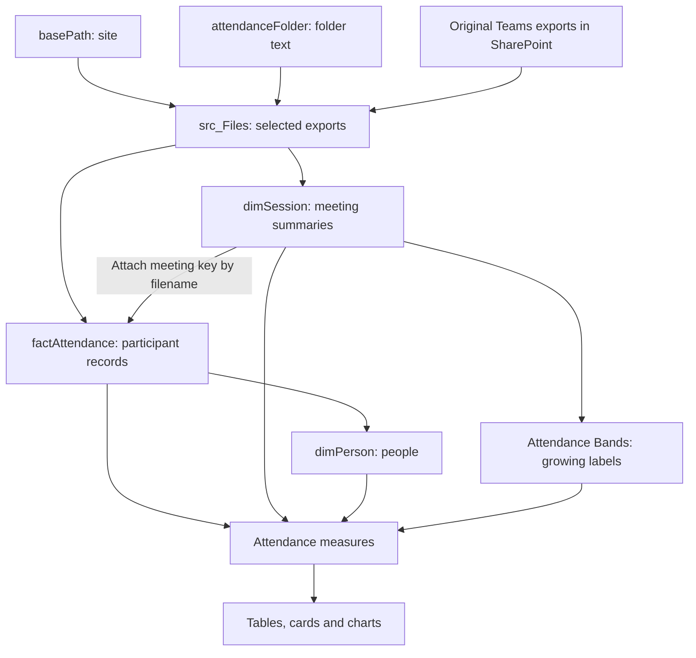

# Attendance data flow and dependencies

[Attendance guide](../attendance_dashboard_guide.md) · [Build in order](attendance_rebuild.md) · [Column reference](attendance_data_dictionary.md)

## From exported file to reported figure

Power Query runs during refresh. It reads the currently selected exports and rebuilds the tables. The model relationships then decide how meeting and person selections reach attendance rows. Measures calculate the displayed values for those selections.

These arrows show dependencies, not relationship directions. For example, dimPerson is prepared from factAttendance during refresh, but the model relationship filters attendance from the person table during report use. See [the separate relationship diagram](../dashboard_relationships/attendance_relationships.md).

## What each stage contributes

| Stage | Reads | Produces or affects |
| --- | --- | --- |
| Parameters | Site and folder choices | The retained source population |
| src_Files | SharePoint file metadata and both selection rules | File names and binaries for both extraction branches |
| dimSession | Section 1 of each selected export | Meeting details, unique key, chronological number and duration denominators |
| factAttendance | Section 2 plus meeting details matched by unique filename | Person-meeting visits, attendance seconds and eight action counts after the typing addition |
| dimPerson | Participant Name and Email from attendance | Person selection and the unique Email relationship |
| Attendance Bands | Number of loaded meeting rows | Exact session-count labels that grow with the history |
| Measures | Prepared columns, related tables and other measures | Counts, averages, time, first/returning attendance and selected-period repeat measures |
| Report field bindings | Measures, meeting/person fields and selections | The precise population used for each displayed value |

AddParticipants creates one participant table per file. Expanded combines their rows. FilterNullNames removes the per-file separator. MergeSession then attaches the meeting key and details using the unique Source File. That join enriches rows; it is not the step that combines exports.

## Main calculation chains

- Attendance rows supply Total Attendance Records and Unique Attendees. Their difference supplies Additional Visits in Selection.
- Selected meeting rows supply Total Sessions. Selected visits divided by selected meetings supply Average Attendees per Session.
- Each visit's attendance seconds and its related meeting seconds supply Average Attendance Coverage %.
- Attendance seconds supply Average Attendance Minutes and Total Attendance Hours.
- Email and all retained chronology supply First Session Attended. New Attendees counts those first visits still visible in the selection; Returning Attendance Events is the remainder of selected visits.
- Visible person Emails and distinct selected meeting keys supply Repeat Participants and Repeat Participant Rate %.
- The disconnected band labels and each visible person's selected meeting count supply People in Attendance Band.

Use [the complete measure definitions](../dashboard_measures/attendance_rebuild_measures.md) when tracing or changing a calculation.

## Trace and change a result

For one meeting's visit count, trace its SharePoint export, extracted participant rows, separator removal, filename match, relationship and selected Total Attendance Records. A source-summary count follows the separate Section 1 route.

For coverage, trace each attendance duration and that same row's related meeting duration. Correct source values can still produce a different figure if a visual uses another formula or filters the wrong table.

Moving a file out of scope removes its contribution at the next refresh. Replacing an export changes history. Adding an older meeting can renumber sessions and reclassify first attendance. Changing a start timestamp changes SessionID. A changed display name can break the accepted one-name-per-Email condition. Check the downstream stages affected by the actual change.

Both extraction branches read file contents in their definitions. This diagram does not promise one physical download per export or a particular refresh execution order. Measure actual refresh performance before introducing caching or helper-query changes.
