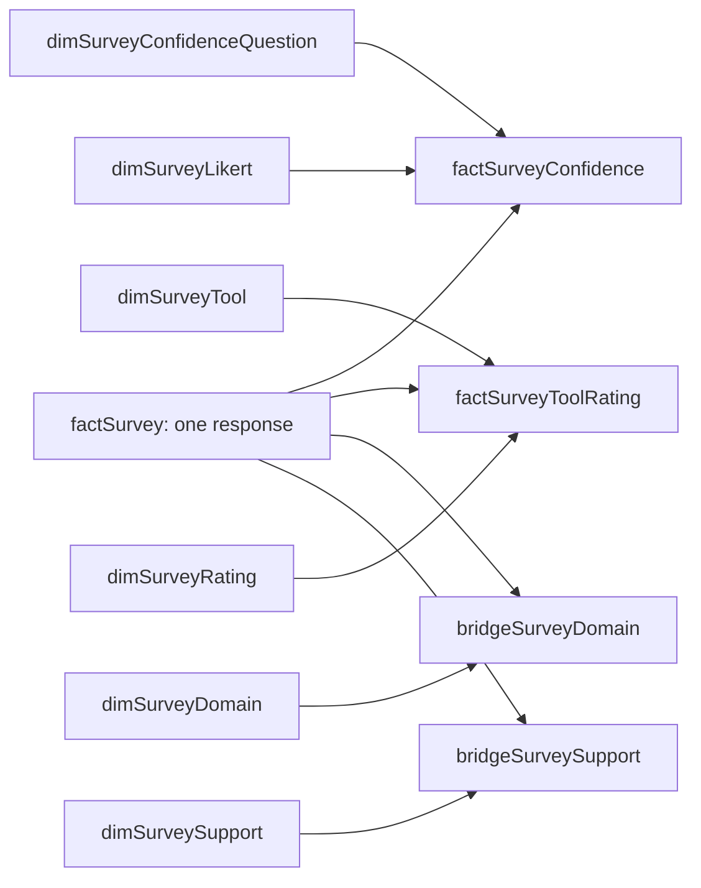

# AI capability survey model

[Survey guide](../survey_dashboard_guide.md) · [Survey measures](survey_measures.md) · [Survey validation](survey_validation.md) · [Glossary](../guide/dashboard_glossary.md)

## Scope and grain

The model is the collection of prepared tables and the links between them. A table's grain means what one row represents. In the response profile, one row is one submitted response. In the confidence table, one row is one response's answer to one statement, including a missing answer.

Keep this model separate from Teams attendance. It reads one anonymous survey snapshot. Count submitted response records; anonymous data does not establish that every record came from a different person.

Use `ResponseID` as the unique, nonblank response key within this snapshot. Do not relate it to SessionID, attendance Email, participant names or another unrelated ID. Anonymous Email is not an identity key. Keep the survey disconnected from attendance tables even if both datasets share the SharePoint `basePath` parameter or reside in one PBIX.

If repeated survey waves are introduced later, use [the proposed multi-wave architecture](survey_waves.md) and a unique response key across waves before combining them. It defines separate wave, question-set, question-version and scale identities, with explicit availability and comparison rules. Repeated anonymous IDs do not identify the same person across surveys. A refreshed snapshot replaces the selected source state; it does not create a longitudinal response store. The model below remains the current single-snapshot specification.

## Query outputs

The public example schema contains 44 raw fields. Retain all source columns in unloaded staging. The prepared stage uses 26: the 13 response-profile fields below, two multi-select lists, six statement fields and five tool-rating fields. Select required fields by their mapped names, rather than their positions in Excel. Extra narrative fields are not required by these calculations.

| Query or table | Grain and expected shape | Load |
| --- | --- | --- |
| `src_FilesCapability` | Selected SharePoint file inventory | Off |
| `stgSurveyRaw` | All columns and rows from the selected workbook's `tblRawData` | Off |
| `stgSurveyPrepared` | One response row; 26 required fields and controlled aliases | Off |
| `factSurvey` | One row per ResponseID; 13 source fields and five display-order fields, 18 columns in total | On |
| `factSurveyConfidence` | One response-statement slot; six rows per ResponseID, including missing or unmapped answers | On |
| `factSurveyToolRating` | One response-tool slot; five rows per ResponseID, including missing or invalid ratings | On |
| `bridgeSurveyDomain` | One distinct ResponseID and Domain pair | On |
| `bridgeSurveySupport` | One distinct ResponseID and Support pair | On |
| `dimSurveyConfidenceQuestion` | Six stable question IDs with source heading, display labels and order | On |
| `dimSurveyLikert` | Five defined agreement labels and scores, 1 through 5 | On |
| `dimSurveyTool` | Five tool IDs, names and display order | On |
| `dimSurveyRating` | Five neutral numerical codes, 1 through 5, with text labels and order | On |
| `dimSurveyDomain` | One distinct retained business-domain label | On |
| `dimSurveySupport` | One distinct retained support/training label | On |

The two answer tables preserve unanswered questions as well as completed answers. For N responses, expect 6 x N confidence rows and 5 x N tool rows. For example, four invented responses create 24 confidence rows and 20 tool rows. Domain and Support row counts vary because a response may select several choices or none.

`factSurvey` holds the unique response profile. The related answer tables contain several rows for that same response, and the two bridge tables contain its selected choices. The name prefix fact does not determine the relationship setting: ResponseID is unique in factSurvey, so that table is the one side of its four relationships.

## Query dependencies and data flow

| Upstream inputs | Downstream output | Responsibility |
| --- | --- | --- |
| basePath and capabilityFolder | src_FilesCapability | Select the controlled workbook inventory |
| src_FilesCapability | stgSurveyRaw | Require one file and read the complete tblRawData Excel Table |
| stgSurveyRaw, question/tool SourceColumn metadata and fxSurveyText | stgSurveyPrepared | Select 26 headings, normalise text and validate response IDs |
| stgSurveyPrepared | factSurvey | Retain 13 profile fields and add five display-order fields |
| stgSurveyPrepared, question metadata and dimSurveyLikert | factSurveyConfidence | Create six slots, match agreement labels and classify answer status |
| stgSurveyPrepared, tool metadata and fxSurveyText | factSurveyToolRating | Create five slots and validate neutral rating codes |
| stgSurveyPrepared and fxSurveyMultiSelect | bridgeSurveyDomain and bridgeSurveySupport | Split the two questions independently into distinct option pairs |
| Each bridge | Its Domain or Support dimension | Retain distinct source option labels |
| Eleven loaded tables and ten model relationships | Survey measure layer | Apply consistent cohorts and explicit denominator rules |
| Survey measures and display dimensions | Two report pages | Present response distributions and development preferences |

These are refresh dependencies, separate from the relationship arrows below. Disabled-load staging still participates in refresh when loaded queries reference it. dimSurveyRating supplies display metadata to the model without changing numerical extraction. Follow [the query installation order](survey_queries.md), then configure relationships and measures.

## Response-profile columns

| Column | Source meaning |
| --- | --- |
| ResponseID | Anonymised source ID within this survey |
| CostCentre | Reported cost centre |
| Grade | Reported grade |
| BusinessWorkType | Primary type of work delivered |
| ClientRoleLevel | Role level or grade worked at in client assignments |
| ClientCapability | Source self-rating of AI/digital capability in a client-facing context |
| ClientAIExposure | Source exposure to or involvement with AI in client work |
| CurrentAICommission | Response about digital or AI-focused projects in the current organisation |
| NonDigitalProductivityUse | Source response about using AI on non-digital projects |
| PriorAIProject | Response about digital or AI projects before joining the current organisation |
| FormalLearning | Source description of current formal AI learning |
| CommissionInterest | Source interest in an AI-focused commission |
| TrainingInterest | Source interest in AI/digital development-plan training |

The example defines four-level capability, exposure and formal-learning categories, three project-interest responses and two training-interest responses. Match the mappings and display order to the actual survey before using them. The loaded profile displays missing categories as `(No answer)`; staging preserves null. This label records a missing answer, rather than a new survey option.

The five additional columns are ClientCapabilityOrder, ClientAIExposureOrder, FormalLearningOrder, CommissionInterestOrder and TrainingInterestOrder. Set each source category's Sort by column property to its corresponding order field, then hide the order fields. Known options follow the defined order; missing or unrecognised labels sort at 99 while retaining their text. These fields control display only. Do not sum or average them as capability, maturity or interest scores, and do not use them as a substitute for a defined grouping rule.

Email, Name, last-modified metadata, timestamps, free-text descriptions and the six terminology fields remain outside this initial loaded profile. They remain available in raw staging. Do not infer the terminology scale from the separate tool-rating or agreement scales.

## Relationships

A relationship connects matching values in two columns. Here, one profile can connect to six confidence-question rows, five tool-question rows and several selected options. These are one-to-many relationships. Single-direction means a selection on the one side can restrict rows on the many side; it does not automatically work backwards.

In Power BI Desktop, open Model view and use Manage relationships > New. For each row below, select the two tables and matching columns, set cardinality to One to many (or Many to one if the tables are displayed in reverse order), set Cross filter direction to Single and leave the relationship active. Check the resulting one and many markers against the table below. Repeat for all ten links.

| One side | Many side | Cardinality |
| --- | --- | --- |
| `factSurvey[ResponseID]` | `factSurveyConfidence[ResponseID]` | 1 to many |
| `factSurvey[ResponseID]` | `factSurveyToolRating[ResponseID]` | 1 to many |
| `factSurvey[ResponseID]` | `bridgeSurveyDomain[ResponseID]` | 1 to many |
| `factSurvey[ResponseID]` | `bridgeSurveySupport[ResponseID]` | 1 to many |
| `dimSurveyConfidenceQuestion[QuestionID]` | `factSurveyConfidence[QuestionID]` | 1 to many |
| `dimSurveyLikert[Score]` | `factSurveyConfidence[Score]` | 1 to many |
| `dimSurveyTool[ToolID]` | `factSurveyToolRating[ToolID]` | 1 to many |
| `dimSurveyRating[Rating]` | `factSurveyToolRating[Rating]` | 1 to many |
| `dimSurveyDomain[Domain]` | `bridgeSurveyDomain[Domain]` | 1 to many |
| `dimSurveySupport[Support]` | `bridgeSurveySupport[Support]` | 1 to many |

Create no link between the two answer tables, between the two bridges, or from any survey object to attendance. Inspect any relationships Power BI created automatically and remove links outside this specification before testing the model. A matching column name alone does not make two datasets related.

Sort `dimSurveyLikert[ResponseLabel]`, question ShortLabel, ToolName and RatingLabel by their dimensions' SortOrder fields. `dimSurveyRating[RatingLabel]` contains the neutral strings `1` through `5`. Use these display dimensions in axes and slicers.

The question dimension retains QuestionText, ShortLabel, SortOrder and SourceColumn. The tool dimension retains its SourceColumn. Hide SourceColumn, the Likert MatchKey, raw keys and bridge columns from ordinary report authors after validating the model; retain them for calculation and troubleshooting. Keep RatingRaw available for validation without using it as the report legend.

## Multi-select filtering contract

A Grade or CostCentre selection filters the response profile and its related answers. A Domain selection reaches its response/Domain choice table but cannot travel backwards to the response profile. The same applies to Support. The measures therefore perform an extra check: include each response only when it matches the selected Domain and Support choices. This selected group is called the cohort.

Use the common response-cohort pattern in [Survey measures](survey_measures.md) for every management measure that must respect these option selections:

1. Start with the response IDs visible under the current response-profile filters.
2. Evaluate the hidden inclusion helper once for each response.
3. If Domain is filtered, require at least one matching Domain pair for that response.
4. If Support is filtered, require at least one matching Support pair for that response.
5. Apply the resulting response IDs to the metric while retaining its question, tool and other intended context.

Interpret several choices within one field as OR. Interpret a Domain condition combined with a Support condition as AND. An unfiltered option dimension must not exclude responses whose choice list was blank. An active option selection deliberately excludes responses without any matching option.

The helper answers Yes or No for one response at a time. It supports the other measures rather than supplying a management result of its own. Keep that inclusion check consistent across response counts, confidence counts and tool-rating counts. This ensures that changing a Domain or Support slicer changes all results to the same selected group.

Do not enable bidirectional filtering merely to make these slicers appear to work. Validate the intended cohort routes directly with [the overlapping-choice fixture](survey_validation.md). Microsoft documents [direct-filter detection](https://learn.microsoft.com/en-us/dax/isfiltered-function-dax) and [intersecting filters with KEEPFILTERS](https://learn.microsoft.com/en-us/dax/keepfilters-function-dax); the selected model routes and cohort meanings above are this design's explicit contract.

## Counting and denominator rules

A response count counts unique response records. A confidence count counts selected response-statement answers. A tool count counts selected response-tool ratings. A bridge count of distinct ResponseID values counts responses choosing the current option set. A pair count instead counts mentions or selections.

Multi-select category bars overlap. Their sum can exceed the response count, and percentages of responses choosing each option can sum above 100%. Count a response once in a combined option set, even if it selected several of those options. Never append the two expanded choice lists into one fact or join them row by row; that multiplies records across combinations.

For the five-category agreement chart, count each answer category against all valid answers to that same question in the same selected group. Selecting the Agree segment must not make its denominator include only Agree. Missing and unrecognised answers stay outside that percentage. Across several questions, the combined percentage describes answers, rather than unique people in a single confidence category.

For Domain or Support shares, state whether the denominator ignores that option's axis and slicer or retains an outer selection. Do not call a share of submitted responses an employee participation rate. This template does not include an eligible-population or invitation roster.

## Interpretation limits

The six agreement statements have a defined five-point response scale. They describe self-report, including confidence, perceived understanding and comfort. Use their distributions and favourable-answer percentages directly. A mean agreement code is an optional descriptive summary, not a validated overall maturity scale.

The five tool fields contain numerical ratings from 1 to 5, but their original question and endpoints are unknown. Use neutral rating-code labels until defined. Do not label code 5 as expert capability, frequent use or positive proficiency solely because an Excel pivot counted it.

Add terminology measures or grouped maturity/confidence categories only after defining their questions, scales and calculation rules. FormalLearning uses None, Introductory, Intermediate and Advanced in this example. Any different learning grouping needs its own definition. Preserve unexpected labels for review rather than assigning invented scores or thresholds.
