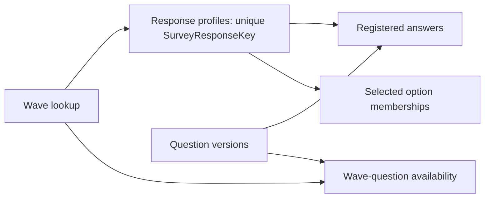

# Plan repeated surveys and changed questionnaires

[Survey guide](../survey_dashboard_guide.md) · [Maintainer runbook](survey_wave_runbook.md) · [Comparisons](survey_wave_comparisons.md) · [Separate prototype](survey_wave_prototype.md)

## Recommendation and current status

Use one survey model with a **wave register** identifying each administration and a **question register** identifying what was asked. Prepare each registered workbook separately, attach stable keys, then append its prepared records. Keep the original six agreement statements unchanged as the main trend questions and add new questions beside them.

This is a proposed extension, not a change to the current working queries. The current reader deliberately accepts one workbook and the current keys identify responses within that snapshot. Do not add another workbook to its selected folder and expect the existing model to append it. Build and check the extension in a separate development copy first.

The separate prototype demonstrates key generation, question-set membership and supported answer handling with synthetic records. It is not the complete SharePoint reader, the full existing profile/cohort model or an installed Power BI migration. Use the implementation and acceptance sequence below before treating repeat-wave operation as available to a routine maintainer.

## What is possible

| Situation | Practical approach | What may be compared |
| --- | --- | --- |
| Same questions, labels and scales | Prepare each workbook with the same question set, add WaveID and append responses | The same defined measures by wave, with each wave's valid-answer count |
| Same meaning, different Excel header or column order | Map the exact new source heading to the existing question version | Compare after confirming that only the source heading changed |
| New question added | Register a new question version and add it to the later question set | Show its results from its introduction onward; earlier waves are Not asked |
| Question intentionally omitted | Omit it from that question set's membership | Exclude it from that wave's answer opportunities; do not invent zero or missing answers |
| Free text changed to a selection | Keep the original text version and create a separate selection version | Show both separately. A common topic alone does not create a common measure |
| Different wording, time reference, scale or option meaning | Create a new version and assess comparability | Default to no numerical difference until an explicit comparison method is agreed |
| Entirely unrelated question set | Share wave/response infrastructure where supported, but retain its own question meanings | Compare only approved shared questions or categories, rather than overall averages |
| Ranking, complex matrices, branching or another new answer structure | Introduce and test a specific adapter | Outside the initial configuration-only contract |

Append means placing response records underneath one another. It does not mean joining anonymous people side by side. Response 17 in the second survey cannot be matched to response 17 in the first. Two invented waves with four submissions each contain eight submissions, not eight verified different people or four matched individuals.

Power Query appends by column names and supplies null for absent columns. That is useful mechanically, but it cannot decide whether a missing column means a question was not asked or whether the export is broken. Register that meaning before appending. See [Microsoft's append documentation](https://learn.microsoft.com/en-us/power-query/append-queries).

### Append or keep separate models

| Option | Benefit | Cost and suitable use |
| --- | --- | --- |
| Append prepared waves into one shared model | One set of common measures, one wave selector and a repeatable maintenance route | Recommended for repeated surveys and supported changed sets; requires the deliberate key/metadata migration |
| Keep a separate table/model for each wave | A quick isolated build can preserve a very different questionnaire | Duplicates queries, dimensions, measures and tests; later waves increase maintenance and comparisons must still use approved matching meanings |
| Keep unrelated surveys separate, with a defined comparison summary | Avoid forcing unrelated measurements into a common score | Appropriate when there are no meaningful shared questions. A report can show separate summaries without joining response rows |

Side-by-side models are therefore possible, but are a weaker default for the intended unattended third/fourth additions. Shared storage is useful even when changed versions remain analytically separate. Never join anonymous response rows to make a paired before/after table.

## Identifiers and dates

| Field | Identifies | Example |
| --- | --- | --- |
| WaveID | One administration, independent of its filename or date | WAVE_001 |
| QuestionSetID | A reusable questionnaire version | SET_001 |
| SourceResponseID | Original positive whole-number ID, unique within a wave | 17 |
| SurveyResponseKey | One response across the whole model | WAVE_001:17 |
| QuestionID | The underlying question/topic identity | WORK_CONFIDENCE |
| QuestionVersionID | Exact wording, answer type and scale | WORK_CONFIDENCE_V1 |
| ScaleID | Defined labels, codes and scoring rules | Agreement5 |
| ComparisonGroupID | Explicitly approved comparison meaning | WORK_CONFIDENCE_AGREEMENT |
| OptionKey | A stable option identity within its question/scale | An approved source-to-option mapping |

Use a restricted WaveID naming rule and reserve the colon as the response-key separator. The prototype enforces that restriction. Keep SourceResponseID as a separate field for source checking. Do not generate permanent response keys from row order, refresh-time indexes, response-count offsets or workbook modification dates.

Record fieldwork opening/closing dates and a deliberately chosen reference date for chart ordering. Dates describe a wave; they do not replace its key. Two surveys may close on the same day, and one may collect responses over several weeks. Do not infer the survey date from file upload time. A completion timestamp can support a separate response-date analysis when its meaning and timezone are defined.

Keep WaveID stable when replacing a corrected export. Update that wave's registered source and revision record, rather than appending the correction as a new wave. Freeze completed source snapshots so a later workbook edit does not silently rewrite the baseline.

## Configuration owned by the maintainer

Maintain a controlled configuration workbook or equivalent tables. Put it outside the current selected survey-data folder during development. Read source workbooks only when registered, rather than interpreting every Excel file in a folder as another survey.

| Configuration table | Required contents | Validation rule |
| --- | --- | --- |
| Waves | WaveID, label, QuestionSetID, exact folder path, exact filename, Excel Table name, dates, display order and Enabled | Unique WaveID; one exact source match for each enabled wave; no source accidentally registered twice |
| Question versions | QuestionVersionID, QuestionID, exact wording, short label, answer type, family, ScaleID, ComparisonGroupID and comparison approval | Unique version; only supported types; known scale/option definitions |
| Question-set map | QuestionSetID, QuestionVersionID, exact SourceColumn and display order | One source mapping per version within a set; every configured heading exists |
| Scale/option maps | ScaleID, source label/code, canonical label/option key, order, nullable score and explicit favourable membership where meaningful | No ambiguous mappings after normalisation; no assumption that all 1–5 scales mean the same thing |
| Profile/cohort mappings | Existing Grade, CostCentre, Domain and Support identities, source versions, availability and approved category mappings | Preserve their meanings across waves; do not silently treat an omitted profile question as unanswered |

Retain source wording and file provenance even when canonical labels are used for presentation. A cosmetic source-heading change can map to the same version. An actual question change receives a new version. Approval of comparison must be deliberate, rather than inferred from similar text or identical numerical ranges.

The initial comparison templates take the conservative route: the exact same approved Agreement5 question version must be present in both waves. Comparing different versions through a crosswalk is a later, separately reviewed extension.

## Target model and migration points

Keep the existing anonymous response profile and the Domain/Support choice structure. Add a Wave lookup and use SurveyResponseKey throughout. For changed instruments, prepare a common answer structure driven by the question-set map, rather than creating a new copy of every dimension and measure for each workbook.

| Current object or behaviour | Required extension |
| --- | --- |
| src_FilesCapability lists selected files | Join the inventory to the wave register by exact folder/name; check each enabled wave independently |
| stgSurveyRaw requires one file overall | Read one registered Excel Table per wave, preserving the wave and source provenance |
| stgSurveyPrepared selects 26 fixed fields | Prepare each set using its registered source mappings and defined profile contract |
| factSurvey is unique by ResponseID | Retain SourceResponseID and make SurveyResponseKey the unique response key |
| Four response-to-child relationships | Rebuild them on SurveyResponseKey, including both option bridges |
| Confidence/tool queries always create six/five slots | Create slots only for questions registered in the administered set, then apply each question's answer rules |
| Fixed confidence/tool metadata | Add question versions, scales and family membership; keep unknown tool meanings neutral |
| ResponseID iterators and distinct counts in the 31 measures | Review every dependency and change it to the combined key; do not change only the relationships |
| Existing confidence favourable measures | Restrict to the intended confidence family and Agreement5; never include a new change scale automatically |
| Domain/Support shares and profile/interest cards | Count only eligible, administered questions in each wave's question-specific base |

One general answer table can hold registered scalar, choice and text answers with their types and versions. Keep a separate multi-choice membership table. Existing confidence/tool tables can act as temporary compatibility views during migration if that simplifies checking, but avoid permanently loading duplicate tables with competing definitions. Their exact replacement and bindings are implementation work, rather than an instruction to install both designs simultaneously.

The full closed-answer model also needs canonical option keys/labels, separate from nullable scores. A recognised tool code can appear in a neutral distribution even when no substantive score is approved. Recognised unscored answers must not disappear merely because a scored-agreement measure counts Valid scored answers. The prototype's raw-answer/status fields illustrate extraction rules; they are not the complete production option model.

The proposed core relationship routes are:

Use active single-direction routes. The availability table records which versions were administered; it does not filter the response table backwards. The existing Domain and Support inclusion checks still require consistent cohort-aware measures. The prototype's Choices output is a general extraction demonstration, rather than a replacement for those complete cohort measures.

Keep wave filters when removing an answer legend or option filter. For explicit baseline/target cards, replace only the ordinary wave selection inside each calculation and rebuild its response cohort afterward. The [comparison reference](survey_wave_comparisons.md) defines those guards and proposed formulas.

## Answer states and denominators

| State | Meaning | Expected answer opportunity? |
| --- | --- | --- |
| Not asked | Version absent from that wave's registered question set | No; create no answer row and display the availability status separately |
| Missing | Version was administered but this response is blank | Yes; retain the slot |
| Unmapped/Invalid | Supplied answer does not match the declared labels or range | Yes; retain raw content for review and exclude it from valid-score percentages |
| Valid scored answer | Recognised answer with a defined score | Yes; include only in measures appropriate to its scale |
| Recognised unscored answer | For example Unable to compare on a change question | Yes; report separately from missing, and exclude it from scored percentages |
| Valid nonnumeric answer | Recognised category, option selection or text | Yes; count according to its type without inventing a score |

For a wave with N responses and K administered scalar questions, there are N x K slots under the prototype's all-questions-shown contract. Across changed sets, sum those wave-specific opportunities. Do not multiply all responses by the largest historical question count. Future response-dependent branching requires eligibility rules beyond set membership and is outside this prototype.

Retain separate meanings for **answered completeness** and **scored coverage** when recognised unscored responses exist. An Unable to compare answer is present but has no numerical score. The current confidence coverage measure is defined for its simpler five-label agreement scale and must not be reused blindly for this new block.

Define answered completeness as supplied answers not marked Missing after type-specific empty handling, divided by administered opportunities; report invalid/unmapped entries separately. A multi-choice cell containing only separators is still Missing. Define recognised-answer coverage using only recognised entries, and scored coverage using answers with approved scores. Specify any response-dependent applicability exclusions before changing these bases. These future definitions are separate from the current snapshot's Confidence Answer Coverage measure.

Question availability also applies to Domain, Support and profile questions. A wave never asked about Support must display Not asked, rather than 0% support demand. Keep those cohort questions unchanged across comparable administrations where possible; version and review any actual change.

## Implementation and acceptance sequence

1. Preserve the current working PBIX and completed first-wave source. Record existing counts and the source inventory.
2. Agree the retained core questions, supported answer types, scale labels and wave dates with the survey lead.
3. Establish the configuration tables and exact registered-file reader in a development copy.
4. Prepare each wave, generate stable response keys and validate keys/mappings before combining records.
5. Change relationships and all key-dependent measures together. Add availability and question-family rules before enabling new question sets.
6. Compare the first wave alone with its unchanged current-model results, using identical source data and selections.
7. Add a synthetic identical second wave. Check reused local IDs, counts, percentages, cohorts and unchanged first-wave results.
8. Add changed sets using only configuration. Check added/retired questions, scale/version boundaries, recognised unscored values and schema errors.
9. Run the baseline/target and Domain/Support tests in Power BI. Generated arithmetic and M extraction alone do not validate DAX context.
10. Record the installed query/measure/model exports, test results and recovery point. Complete a witnessed fourth-wave/third-set exercise with the future maintainer before describing the handover as independent operation.

The detailed [runbook](survey_wave_runbook.md) identifies routine configuration steps, deliberate stop conditions and recovery. The [prototype](survey_wave_prototype.md) supplies a small executable extraction demonstration, with generated fixtures using invented records.
